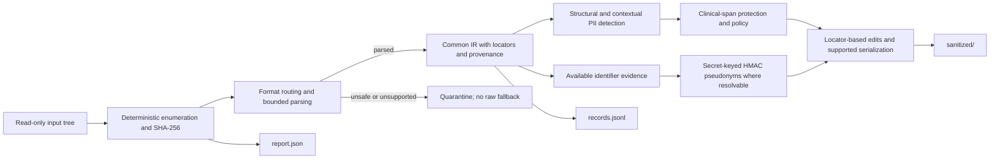

# Secret Wards

**An offline, CPU-only privacy firewall for synthetic, multilingual Indian healthcare exports.** This Python project parses supported files, detects and edits selected direct identifiers, writes deterministic keyed record tokens where evidence is available, and quarantines inputs it cannot safely parse. It is a competition prototype, not a certified anonymization system.

## Status at a glance

The supplied Team Kit development set contains 200 files. The latest measured run exported 197 and quarantined 3 (empty, malformed JSON, and excessive nesting). On labeled PII surfaces, 27 of 3,234 remained visible (0.8%); measured clinical values retained were 4,825 of 4,855 (99.4%). The independent toolkit contract validator passed on the run. The Team Kit practice self-check measured linkage at precision 1.00, recall 0.51 and F0.5 0.84, with zero observed false merges. Same-secret output determinism and different-secret token changes were observed. The full test suite passes 145 tests. These results apply only to this practice set and local Windows evaluation; they do not establish hidden-set performance, anonymity, or submission readiness.

| Practice-set check | Latest measured result |
|---|---:|
| Files | 197 exported, 3 quarantined, 0 unaccounted / 200 |
| Labeled PII surfaces still visible | 27 / 3,234 (0.8%) |
| By script | Latin 0.4%, Devanagari 0.0%, Hinglish 14.4% |
| By channel | content 0.8%, metadata 5.0%; filename, header, JSON key and base64 0% observed |
| Clinical values retained | 4,825 / 4,855 (99.4%) |
| Practice-set linkage score | precision 1.00, recall 0.51, F0.5 0.84 (0 false merges in this self-check) |
| Determinism | same-secret outputs matched; changed secret changed output |
| Independent verifier | Fails with 492 NAME candidates; candidates need triage and are not all confirmed PII |
| Optional capabilities missing in the measured environment | cross-script transliteration package, phone validation, PDF text extraction, imaging and OCR |

Hinglish remains the largest measured gap. “0%” in a channel means no labeled surface was missed there in this run, not that the channel is universally safe. See [docs/BASELINE_RESULTS.md](docs/BASELINE_RESULTS.md) and [docs/KNOWN_LIMITATIONS.md](docs/KNOWN_LIMITATIONS.md) for methods and caveats.

## Requirements and setup

- Python 3.10 or later.
- Linux is the target runtime; development has also been exercised on Windows. The full organizer run and resource limits must still be confirmed on Linux.
- `RAKSHA_SECRET` must be provided by the runner. The program must not write it to disk, logs, or reports.
- Production execution is offline. No model downloads, LLMs, hosted services, or telemetry are used.

Create an environment and install the declared dependencies:

```bash
python3 -m venv .venv
. .venv/bin/activate
python -m pip install -r requirements.txt
```

The required competition interface is:

```bash
export RAKSHA_SECRET='replace-with-a-random-release-secret'
python main.py --input /path/to/input --output /path/to/output
```

PowerShell equivalent:

```powershell
$env:RAKSHA_SECRET = 'replace-with-a-random-release-secret'
python main.py --input 'C:\data\input' --output 'C:\data\output'
```

The output root contains `sanitized/`, `report.json`, and `records.jsonl`. Unparseable or unsafe inputs are quarantined and are not copied unchanged into `sanitized/`. Inspect the report and quarantine counts after every run. The current implementation uses optional format libraries when available; missing libraries reduce supported processing and can cause files to be quarantined.

## Architecture and data flow



The pipeline entry point is `main.py`; orchestration is in `src/pipeline.py`, and release writing is in `src/output/writer.py`. The central representation and provenance are in `src/ir.py`. The common IR allows format-specific parsers and serializers to share detection and edits without converting all documents to XML.

## How each part works

| Part | Current behavior | Main code |
|---|---|---|
| Ingestion | Routes by file content and extension, decodes supported text encodings, parses CSV/TSV, JSON/FHIR-shaped JSON, XML and text, enforces bounds, records source locations, and quarantines parse failures. PDF/image support depends on optional local tools. | `src/ingestion/` |
| Common IR | Keeps source structure and types with locators, annotations and pending edits. The original `structure.data` is treated as source evidence; edits are represented separately. | `src/ir.py` |
| Normalization | Provides deterministic Unicode, date, name and phone normalization annotations. A built-in approximate Devanagari transliteration fallback is available; it must not be treated as proof that two identities match. | `src/normalization/` |
| Understanding | Uses hierarchy, labels, section context and nearby marker phrases to add deterministic semantic annotations and represent uncertainty. This is evidence, not a cross-document identity resolver. | `src/understanding/` |
| Detection | Combines identifier patterns, field/header/key semantics, structural metadata and context-aware name/relative rules. Clinical protection is intended to preserve diagnoses, medicines, doses and measurements. | `src/detection/`, `src/policy/` |
| Pseudonymization | Derives keyed pseudonyms from available identifier evidence using HMAC and `RAKSHA_SECRET`; pseudonyms are written into exported records and `records.jsonl`. Evidence is limited and does not constitute robust cross-hospital linkage. | `src/privacy/pseudonyms.py`, `src/output/writer.py` |
| Output | Applies locator-based changes, writes supported formats and the report/record manifest, and avoids copying quarantined raw bytes into the release. | `src/transformation/`, `src/output/` |
| Evaluation | Includes unit/adversarial tests, the supplied contract validator, development-set scorecard and a separate verifier. The verifier is an additional diagnostic, not currently a mandatory release gate. | `tests/`, `tools/`, `team-kit/` |

### Output contract

The supplied Team Kit `docs/SPEC.md` and validators are authoritative. `report.json` identifies each source by SHA-256 rather than its original name, and records its status and output mapping. `records.jsonl` uses `row:N` for CSV/TSV, JSON Pointer for nested JSON records, and `doc` for document-level records. A pseudonym is only reported when supported by the current extraction logic; otherwise the record may be unlinked (`null`).

## Security design

- Inputs are read without intentional modification; each is hashed for accounting.
- Parsing is bounded and deterministic. Unsupported, malformed, empty, or over-depth files are quarantined instead of being copied as if sanitized.
- Source locations and annotations keep edits separate from original parsed structure, and serialization applies explicit edits.
- Pseudonyms use keyed HMAC rather than plain hashes; the secret comes from the environment and is not included in output.
- Reports use input content hashes instead of original filenames. Output names and side channels still require review for every release.
- There is no network use, telemetry, or runtime model download.

This design reduces exposure but does not yet provide all required security properties: raw intermediate data may exist in process memory, quarantine hardening/encryption is incomplete, and independent verification is not a blocking release gate. Do not use real patient data.

## Test and evaluation commands

Run unit tests:

```bash
python -m pytest -q
```

Run the practice corpus and official checks using the organizer's Team Kit ZIP. The repository includes the kit helper scripts under `team-kit/`; extract the practice input files into `team-kit/dev/input` or set `KIT` and `INPUT` to their extracted paths:

```bash
export RAKSHA_SECRET='practice-only-secret'
KIT=team-kit
INPUT="$KIT/dev/input"
python main.py --input "$INPUT" --output build/practice-output
python "$KIT/validate_output.py" --input "$INPUT" --output build/practice-output
python "$KIT/check_dev.py" --output build/practice-output
python tools/verify.py "$INPUT" build/practice-output
```

Use synthetic data only. Keep generated output, secrets, and private test data out of version control. For score definitions, denominators, and interpretation, see [docs/BASELINE_RESULTS.md](docs/BASELINE_RESULTS.md).

## Known limitations and next work

- Hinglish names/relatives and some localities still leak; 27 labeled surfaces remained in the latest run. The independent verifier reports 492 name candidates, some likely benign but requiring review.
- The practice self-check measures pseudonym linkage at precision 1.00, recall 0.51 and F0.5 0.84 (0 false merges) on this synthetic set. This is not a hidden-set guarantee; alias resolution and general cross-hospital identity matching remain limited.
- Date shifting, age bands, configurable location generalization and rare-combination suppression are not implemented in the release path.
- Approximate transliteration is not validated identity matching; OCR, image metadata and PDF text processing depend on missing optional local backends.
- The separate verifier may still report candidate names and does not currently stop a release automatically.
- The latest measured run is on Windows with a temporary compatibility shim for Linux's `resource` module. Linux runtime, full resource limits, held-out variants, comprehensive FHIR reference validation, and changed-secret behavior need final confirmation.
- Practice data is synthetic and small; the measured score does not establish hidden-set accuracy or anonymity.

For detailed findings and prioritized fixes, see [docs/ENGINEERING_AUDIT.md](docs/ENGINEERING_AUDIT.md), [docs/KNOWN_LIMITATIONS.md](docs/KNOWN_LIMITATIONS.md), and [docs/architecture.md](docs/architecture.md). The project brief is [docs/Project-Brief.pdf](docs/Project-Brief.pdf).
