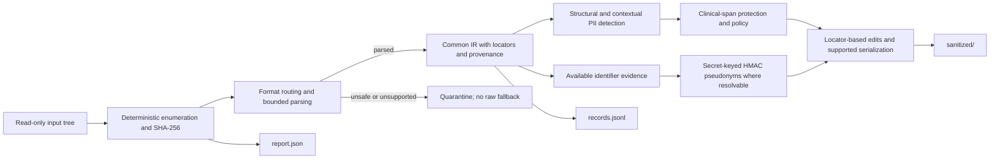

# Secret Wards

**An offline, CPU-only privacy firewall for synthetic, multilingual Indian healthcare exports.** This Python project parses supported files, detects and edits selected direct identifiers, writes deterministic keyed record tokens where evidence is available, and quarantines inputs it cannot safely parse. It is a competition prototype, not a certified anonymization system.

## Status at a glance

The supplied Team Kit development set contains 200 files. In the latest Linux evaluation, 197 were sanitized and 3 were quarantined, with no unaccounted inputs. Both toolkit scorers found 0 visible labeled PII surfaces (scorecard: 0/3,234; practice self-check: 0/3,230); 4,825/4,855 clinical values were retained (99.38%). Linkage scored precision 1.00, recall 0.61 and F0.5 0.89, with zero observed false merges. The independent verifier and output-contract validator passed. All 162 project tests passed on Python 3.10. The organizer's three-run check passed under Linux with 2 CPUs, 4 GB RAM and no network: same-secret output was identical, a changed secret changed output, and input files were unchanged. These are synthetic development-set results, not hidden-set performance or an anonymity guarantee.

| Practice-set check | Latest measured result |
|---|---:|
| Files | 197 exported, 3 quarantined, 0 unaccounted / 200 |
| Labeled PII surfaces still visible | 0 / 3,234 (independent scorecard); 0 / 3,230 (practice self-check) |
| By script and channel | 0 labeled misses in the measured Latin, Devanagari, Hinglish, content, filename, header, key, metadata and base64 groups |
| Clinical values retained | 4,825 / 4,855 (99.38%) |
| Practice-set linkage score | precision 1.00, recall 0.61, F0.5 0.89 (0 false merges in this self-check) |
| Determinism | same-secret outputs matched; changed secret changed output |
| Output contract and independent verifier | Passed; verifier inspected all 200 input files and found no surviving identifier candidates |
| Files and canaries | 197 exported, 3 quarantined, 0 unaccounted; 0 / 4 canaries found |
| Linux runtime | Python 3.10, 2 CPUs, 4 GB RAM, no network; organizer three-run check passed |

Zero labeled misses describe only this synthetic practice corpus and its answer key. The Linux environment lacked the `pdftoppm` and `tesseract` executables, so image-only PDF rendering and OCR were unavailable; this limitation is recorded in the run report. See [docs/BASELINE_RESULTS.md](docs/BASELINE_RESULTS.md) and [docs/KNOWN_LIMITATIONS.md](docs/KNOWN_LIMITATIONS.md) for measurement scope and caveats.

## Requirements and setup

- Python 3.10 or later.
- Linux is the target runtime. The full organizer check was run in a Python 3.10 Linux container with 2 CPUs, 4 GB RAM and networking disabled. Native OCR tools were absent and are reported as missing capabilities.
- `RAKSHA_SECRET` must be provided by the runner. The program must not write it to disk, logs, or reports.
- Production execution is offline. No model downloads, LLMs, hosted services, or telemetry are used.

Create an environment and install the declared dependencies:

```bash
python3 -m venv .venv
. .venv/bin/activate
python -m pip install -r requirements.txt
```

For project tests and rebuilding the Project Brief PDF, install the development/documentation tools:

```bash
python -m pip install -r requirements-dev.txt
```

### Technology and dependency inventory

This section lists packages used by the current implementation. Optional extraction backends are
checked at runtime; when a backend is missing, the report records the degradation and affected
files may be quarantined.

| Technology / package | Role and where it is used | Status |
|---|---|---|
| Python 3.10+ | Main implementation language, command-line application, tests and tools. `main.py` is the entry point; `src/` contains the processing pipeline. | Required |
| Python standard library | `argparse`/`os`/`sys`/`pathlib` for the CLI and paths; `csv`, `json`, `xml.etree.ElementTree` and `io` for format parsing/rendering; `hashlib` and `hmac` for SHA-256 accounting and keyed pseudonyms; `unicodedata` and `re` for Unicode/script handling and deterministic pattern rules; `datetime`, `decimal`, `urllib.parse`, `base64`, `binascii`, `logging`, `shutil`, `subprocess`, `tempfile`, `time`, `zlib`, `math`, `collections`, `dataclasses`, `enum`, `typing`, `ast`, and `importlib` support normalization, bounded extraction, safe logging, validation, and development tools. | Used throughout runtime and tooling |
| Pydantic 2 (`pydantic==2.14.4`) | Typed validation for the common intermediate representation and its nested source metadata in `src/ir.py`. | Required at runtime |
| PyYAML (`PyYAML==6.0.4`, imported as `yaml`) | Loads `config/policy.yaml` in `src/pipeline.py`; if missing, the pipeline falls back to a limited flat key/value reader. | Declared runtime package; capability is reported |
| `indic-transliteration==2.3.83` | Indic-script transliteration in `src/normalization/transliteration.py`; a small approximate fallback is available. Transliteration is not proof of identity equivalence. | Declared optional runtime backend |
| `phonenumbers==9.0.44` | Phone-number parsing, validation, region metadata and E.164 formatting in `src/normalization/phones.py`. | Declared optional runtime backend |
| `pycountry==26.2.16` | Country-name/code lookup in `src/normalization/other.py`. | Declared optional runtime backend |
| `pypdf==7.2.0` | Reads PDF text layers in `src/ingestion/scanned.py`. | Declared optional runtime backend |
| Pillow (`Pillow==12.3.0`, imported as `PIL`) | Reads image metadata and opens image content for OCR in `src/ingestion/scanned.py`. | Declared optional runtime backend |
| `pytesseract==0.3.13` and external Tesseract executable | Python OCR wrapper and the native OCR executable are both needed to read image pixels. | Wrapper declared; executable installed separately |
| `pdftoppm` (Poppler command-line utility) | Renders image-only PDF pages for OCR. | Optional system tool; not installed by pip |
| pytest (`pytest==9.2.0`) | Runs the project test suite under `tests/` (`python -m pytest -q`). | Development dependency in `requirements-dev.txt` |
| ReportLab (`reportlab==5.1.0`) | Builds the project brief PDF via `tools/build_project_brief.py`. | Documentation-build dependency in `requirements-dev.txt` |
| Bash | Runs `tools/run_dev.sh` for the development workflow in a Linux/Unix environment. | Development environment/tool |

The dependency list is intentionally limited to packages imported by the current implementation.
Encoding is handled by the explicit UTF-8, UTF-16 and CP1252 logic in `src/ingestion/encoding.py`.
FHIR-shaped JSON uses the common JSON IR; full FHIR R4 schema validation is not implemented.
HMAC pseudonyms use Python's standard-library `hmac`; persisted-data encryption is not implemented.

### Formats and project stack

- **Input/output formats:** CSV and TSV, JSON, FHIR R4 Bundles represented as JSON, XML, and
  decoded text. PDF and image files can be scanned through the optional local extraction tools.
  The common intermediate representation and source locators are implemented in `src/ir.py`.
- **Configuration and interfaces:** YAML policy (`config/policy.yaml`, with the fallback noted
  above), TOML submission metadata (`raksha.toml`), a Python CLI (`main.py`), and JSON/JSONL
  output (`report.json` and `records.jsonl`).
- **Runtime model:** offline, CPU-only Python; deterministic rules and transformations; no web
  framework, database, hosted service, LLM, or runtime network dependency is used.
- **Testing and evaluation:** pytest unit/adversarial tests, the supplied Team Kit output
  validator, and repository tools in `tools/` for verification, scoring, and the project brief.

The required competition interface is:

```bash
export RAKSHA_SECRET='replace-with-a-random-release-secret'
python main.py --input /path/to/input --output /path/to/output
```

PowerShell equivalent:

```powershell
$env:RAKSHA_SECRET = 'replace-with-a-random-release-secret'
python main.py --input 'C:\data\input' --output 'C:\data\output'
```

The output root contains `sanitized/`, `report.json`, and `records.jsonl`. Unparseable or unsafe inputs are quarantined and are not copied unchanged into `sanitized/`. Inspect the report and quarantine counts after every run. The current implementation uses optional format libraries when available; missing libraries reduce supported processing and can cause files to be quarantined.

## Architecture and data flow



The pipeline entry point is `main.py`; orchestration is in `src/pipeline.py`, and release writing is in `src/output/writer.py`. The central representation and provenance are in `src/ir.py`. The common IR allows format-specific parsers and serializers to share detection and edits without converting all documents to XML.

## How each part works

| Part | Current behavior | Main code |
|---|---|---|
| Ingestion | Routes by file content and extension, decodes supported text encodings, parses CSV/TSV, JSON/FHIR-shaped JSON, XML and text, enforces bounds, records source locations, and quarantines parse failures. PDF/image support depends on optional local tools. | `src/ingestion/` |
| Common IR | Keeps source structure and types with locators, annotations and pending edits. The original `structure.data` is treated as source evidence; edits are represented separately. | `src/ir.py` |
| Normalization | Provides deterministic Unicode, date, name and phone normalization annotations. A built-in approximate Devanagari transliteration fallback is available; it must not be treated as proof that two identities match. | `src/normalization/` |
| Understanding | Uses hierarchy, labels, section context and nearby marker phrases to add deterministic semantic annotations and represent uncertainty. This is evidence, not a cross-document identity resolver. | `src/understanding/` |
| Detection | Combines identifier patterns, field/header/key semantics, structural metadata and context-aware name/relative rules. Clinical protection is intended to preserve diagnoses, medicines, doses and measurements. | `src/detection/`, `src/policy/` |
| Linkage and pseudonymization | Keeps strong direct-identifier tokens; can link records on an exact patient-name plus phone pair when sex/DOB evidence does not conflict. Name-only and phone-only links are rejected. HMAC token generation is domain separated and secret keyed. | `src/privacy/linkage.py`, `src/privacy/pseudonyms.py` |
| Privacy transforms | Applies same-patient date shifts, age bands, village/locality generalization and PIN-prefix masking where supported by structure and patient evidence. Rare-combination suppression is not implemented. | `src/privacy/transforms.py`, `src/transformation/` |
| Output | Applies locator-based changes, writes supported formats and the report/record manifest, and quarantines unsafe parse failures rather than releasing raw bytes. | `src/transformation/`, `src/output/` |
| Evaluation | Includes 162 project tests, toolkit contract checking, development-set scorecard and an independent verifier. The verifier is run separately and is not automatically a blocking pipeline stage. | `tests/`, `tools/`, `team-kit/` |

### Output contract

The supplied Team Kit `docs/SPEC.md` and validators are authoritative. `report.json` identifies each source by SHA-256 rather than its original name, and records its status and output mapping. `records.jsonl` uses `row:N` for CSV/TSV, JSON Pointer for nested JSON records, and `doc` for document-level records. A pseudonym is only reported when supported by the current extraction logic; otherwise the record may be unlinked (`null`).

## Security design

- Inputs are read without intentional modification; each is hashed for accounting.
- Parsing is bounded and deterministic. Unsupported, malformed, empty, or over-depth files are quarantined instead of being copied as if sanitized.
- Source locations and annotations keep edits separate from original parsed structure, and serialization applies explicit edits.
- Pseudonyms use keyed HMAC rather than plain hashes; the secret comes from the environment and is not included in output.
- Reports use input content hashes instead of original filenames. Output names and side channels still require review for every release.
- There is no network use, telemetry, or runtime model download.

This design reduces exposure but does not yet provide all required security properties: raw intermediate data may exist in process memory, quarantine hardening/encryption is incomplete, and independent verification is not a blocking release gate. Do not use real patient data.

## Test and evaluation commands

Run unit tests:

```bash
python -m pytest -q
```

Run the practice corpus and official checks using the organizer's Team Kit ZIP. The repository includes the kit helper scripts under `team-kit/`; extract the practice input files into `team-kit/dev/input` or set `KIT` and `INPUT` to their extracted paths:

```bash
export RAKSHA_SECRET='practice-only-secret'
KIT=team-kit
INPUT="$KIT/dev/input"
python main.py --input "$INPUT" --output build/practice-output
python "$KIT/validate_output.py" --input "$INPUT" --output build/practice-output
python "$KIT/check_dev.py" --output build/practice-output
python tools/scorecard.py --kit "$KIT" --output build/practice-output
python tools/verify.py "$INPUT" build/practice-output
python "$KIT/check_submission.py" --repo . --input "$INPUT" --run
```

Use synthetic data only. Keep generated output, secrets, and private test data out of version control. For score definitions, denominators, and interpretation, see [docs/BASELINE_RESULTS.md](docs/BASELINE_RESULTS.md).

## Known limitations and next work

- The practice corpus had 0 labeled direct-PII misses in two toolkit measurements, but it is small and synthetic; this is not a hidden-set guarantee or proof of anonymity.
- Linkage uses direct identifiers and exact patient-name/phone composites with sex/DOB conflict checks. Alias resolution, cross-script matching, identity review states and robust homonym handling remain limited; same-name-only linking is forbidden.
- Date shifting, age bands, locality generalization and PIN masking are implemented for supported structures. Rare-combination suppression and attack-based re-identification-risk measurement remain unsupported; XML and free-text generalization coverage is limited.
- Linux evaluation reported missing native `pdftoppm` and `tesseract` executables. Text-layer PDF parsing and metadata extraction are available through Python packages, but image-only PDF rendering and OCR are not assured.
- The independent verifier passed the current corpus but is a separate tool, not an automatic blocking pipeline stage. Full FHIR R4 schema and reference validation remain incomplete.
- Sensitive parsed values exist in process memory. Persisted intermediate-data encryption, secure-deletion guarantees and a complete key-rotation lifecycle are not implemented.
- Practice results do not establish hidden-set accuracy, full multilingual performance, anonymity or safety for real patient records.

For detailed findings and prioritized fixes, see [docs/ENGINEERING_AUDIT.md](docs/ENGINEERING_AUDIT.md), [docs/KNOWN_LIMITATIONS.md](docs/KNOWN_LIMITATIONS.md), and [docs/architecture.md](docs/architecture.md). The project brief is [docs/Project-Brief.pdf](docs/Project-Brief.pdf).
