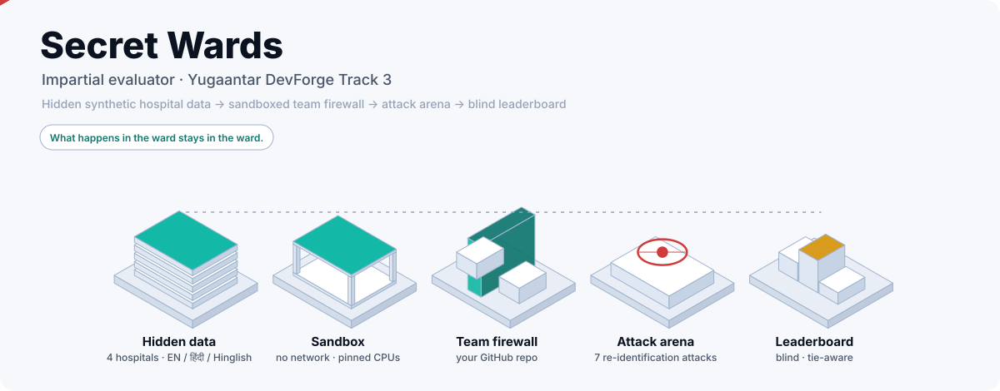

<div align="center">

<picture>
  <source media="(prefers-color-scheme: dark)" srcset="docs/assets/hero-dark.svg">
  
</picture>

# Secret Wards · Team Kit

**Yugaantar DevForge · Track 3 · Privacy Engineering**

*What happens in the ward stays in the ward.*

[**Start here**](START_HERE.md) · [Problem statement](docs/PROBLEM_STATEMENT.md) · [Submission format](docs/SPEC.md) · [Scoring](docs/SCORING.md) · [FAQ](docs/FAQ.md)

</div>

---

## The challenge in one paragraph

Hospitals are merging messy patient records (English, Hindi and Hinglish; CSV, JSON,
FHIR, notes, WhatsApp forwards) into one research database. Build an **offline, CPU-only,
LLM-free privacy firewall** that removes every piece of personal data, keeps every
medical value exactly intact, and gives each real patient one stable fake ID across all
files. After you submit, **our attacker** uses a voter list and known facts to hunt for
patients in your output. Make it fail.

All data is synthetic. No real patient appears anywhere.

## What's in this kit

| | Path | What it is |
|---|---|---|
| 📖 | [`START_HERE.md`](START_HERE.md) | **read first**: the whole challenge in plain words, a data tour, a build plan, a checklist |
| 🗂️ | [`dev/input/`](dev/input) | the practice dataset: 200 files, 48 patients, 4 hospitals, every trap |
| 🔑 | [`dev/truth/truth.json`](dev/truth) | the practice **answer key**: every piece of personal data, every true patient |
| 🕵️ | [`dev/attacker/`](dev/attacker) | what the attacker knows: a voter-list register and known facts |
| 📝 | [`brief/`](brief) | a fill-in template for the 2-page Project Brief PDF |
| 🧱 | [`starter/`](starter) | a working skeleton that already writes the correct output format |
| ✅ | [`validate_output.py`](validate_output.py) | the format checker; must print `CONTRACT OK` |
| 🚦 | [`check_submission.py`](check_submission.py) | the pre-submit check: `raksha.toml`, README, PDF, runs your repo 3 times; must print `READY TO SUBMIT` |
| 📊 | [`check_dev.py`](check_dev.py) | the practice self-check: leaks, canaries, medical values kept, linking quality |
| ⚖️ | [`scoring.toml`](scoring.toml) | every weight, threshold and penalty, as used by the official evaluator |
| 📚 | [`docs/`](docs) | statement, format, scoring, attacks, dataset, sandbox, fairness, FAQ |

## Quick start (5 minutes)

```bash
git clone https://github.com/kartikeyajay2006/Secret-Wards.git && cd Secret-Wards

RAKSHA_SECRET=practice python3 starter/main.py --input dev/input --output my_output
python3 validate_output.py --input dev/input --output my_output     # → CONTRACT OK
python3 check_dev.py --output my_output --show 10                    # → what you still leak
```

Everything above uses only the Python standard library (3.10+).

## How to submit

**1. Put `raksha.toml` at the root of your repository:**

```toml
[submission]
name  = "your-team-name"
setup = "pip install -r requirements.txt"                    # run once, internet allowed
run   = "python main.py --input {input} --output {output}"   # run with NO internet
```

**2. Your program writes this into `{output}`:**

```
output/
├── sanitized/       ← cleaned files: same folders, names and formats as the input
├── report.json      ← every input file (by SHA-256, never by name) + honest totals
└── records.jsonl    ← which record belongs to which fake patient ID
```

```json
{"file": "sanitized/registration/hospital.csv", "loc": "row:12", "patient": "PSN-7Q2K9D"}
{"file": "sanitized/opd/visits.json",           "loc": "/visits/3", "patient": "PSN-7Q2K9D"}
{"file": "sanitized/discharge/note1.txt",       "loc": "doc",      "patient": "PSN-7Q2K9D"}
```

**3. Check:**

```bash
python3 validate_output.py --input dev/input --output my_output     # → CONTRACT OK
python3 check_submission.py --repo ../your-repo --run               # → READY TO SUBMIT
```

**4. Submit your GitHub link and your 2-page Project Brief PDF before the deadline.** We freeze your last commit at the deadline.
How to write the brief: [docs/PROJECT_BRIEF.md](docs/PROJECT_BRIEF.md) · template: [brief/PROJECT_BRIEF_TEMPLATE.md](brief/PROJECT_BRIEF_TEMPLATE.md).

Full contract: [docs/SPEC.md](docs/SPEC.md).

## How you are scored (100 points)

| | Area | Pts | In plain words |
|---|---|---:|---|
| 🛡️ | Privacy against attacks | **25** | how few patients our attacker can re-identify from your output |
| 🔎 | Personal data detection | **20** | PII removed in English, हिंदी and Hinglish, also in file names, keys, headers and attachments; doctors, doses and diseases kept |
| 💊 | Medical data preserved | **20** | medicines, doses, vitals, labs, diagnoses, exact stay lengths, truthful age bands |
| 🔗 | Patient identity consistency | **15** | the same patient gets the same fake ID everywhere; different people are never merged |
| 📦 | Output quality & validity | **10** | valid CSV / JSON / FHIR, an honest report, no leaks in logs or temp files, proper quarantine |
| ⚡ | Speed & reliability | **10** | fast, low memory, no crashes, identical output on repeat runs |
| ⛔ | Penalties | − | real ID or full name leaked −1 · **canary** leaked −3 · raw file copied −5 · false success −10 · input modified −5 |

Your system runs on **3 hidden datasets** (at least one with names, labels and formats
never seen in practice), then once more with the same secret and once with a different
one. **Ties:** you rank above another team only if you score more than 1 point higher on
**every** hidden dataset.

| Reference point (official evaluator, practice data) | Score |
|---|---:|
| copy everything unchanged | below 0 |
| `starter/` as shipped (regex only, links nothing) | ≈ 8 |
| delete everything | ≈ 20 |
| a solid firewall built by the organisers against practice data | ≈ 79 on practice, ≈ 50 on an unseen-format dataset |

That last gap is the point: **build for data you have not seen.**

## Ground rules (short)

* **No LLMs**, no generative models, no pretrained transformers above 50M parameters.
  Rules, gazetteers, CRFs, classical ML and small self-trained models are fine; declare them.
* **Offline, CPU-only:** 2 CPUs, 4 GB RAM, no internet during `run`, no GPU.
* **Deterministic:** same input + same `RAKSHA_SECRET` → identical output; another secret → different fake IDs and dates.
* **Zero leaks:** planted canaries anywhere (outputs, logs, temp files, errors, report) are heavily penalised.
* **Fail safe:** quarantine what you can't clean. Never copy raw files or silently skip files.
* **Original work:** the repository is created during the hackathon.

Full rules: [docs/PROBLEM_STATEMENT.md §7](docs/PROBLEM_STATEMENT.md).

## 📚 Documentation

| Document | Read it when you want to know… |
|---|---|
| [START_HERE.md](START_HERE.md) | everything, in plain words: start here |
| [docs/PROBLEM_STATEMENT.md](docs/PROBLEM_STATEMENT.md) | the official Track 3 statement |
| [docs/SPEC.md](docs/SPEC.md) | the exact submission format: `raksha.toml`, environment, `report.json`, `records.jsonl` |
| [docs/SCORING.md](docs/SCORING.md) | every formula, weight, threshold and penalty |
| [docs/ATTACKS.md](docs/ATTACKS.md) | what the attacker knows and the attacks it runs |
| [docs/DATASET.md](docs/DATASET.md) | how the data is built: hospitals, traps, canaries, the unseen-format round |
| [docs/SANDBOX.md](docs/SANDBOX.md) | what your code can and cannot do on our machine |
| [docs/FAIRNESS.md](docs/FAIRNESS.md) | how the ranking is kept impartial: seed commitment, freeze, blind board, ties |
| [docs/PROJECT_BRIEF.md](docs/PROJECT_BRIEF.md) | what to put in the 2-page Project Brief PDF |
| [docs/FAQ.md](docs/FAQ.md) | quick answers to common questions |

## Recommended reading and libraries

`regex`, `phonenumbers`, `dateparser` · `indic-transliteration`, `indic-nlp-library` ·
`rapidfuzz`, `jellyfish` · `sklearn-crfsuite`, spaCy rule-based `Matcher` · `splink`,
`recordlinkage` · `fhir.resources`, `pydantic` · `cryptography` (AES-GCM, HMAC) ·
`anonymeter`, `pycanon`. Concepts: Indian name structures, k-anonymity and l-diversity,
Fellegi–Sunter record linkage, HIPAA Safe Harbor, India's DPDP Act 2023, ABDM guidelines.

---

<div align="center">

Questions? Ask the Track 3 organisers. Licence: [MIT](LICENSE). All data is synthetic.

</div>
